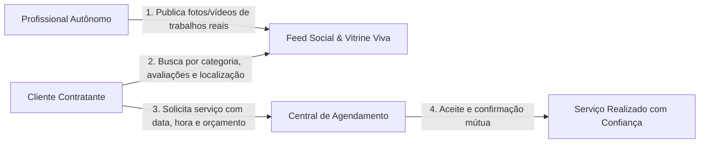
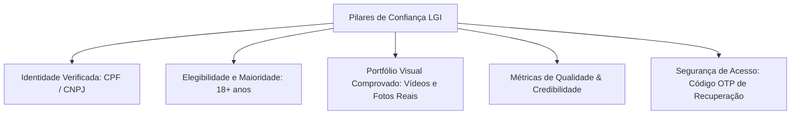
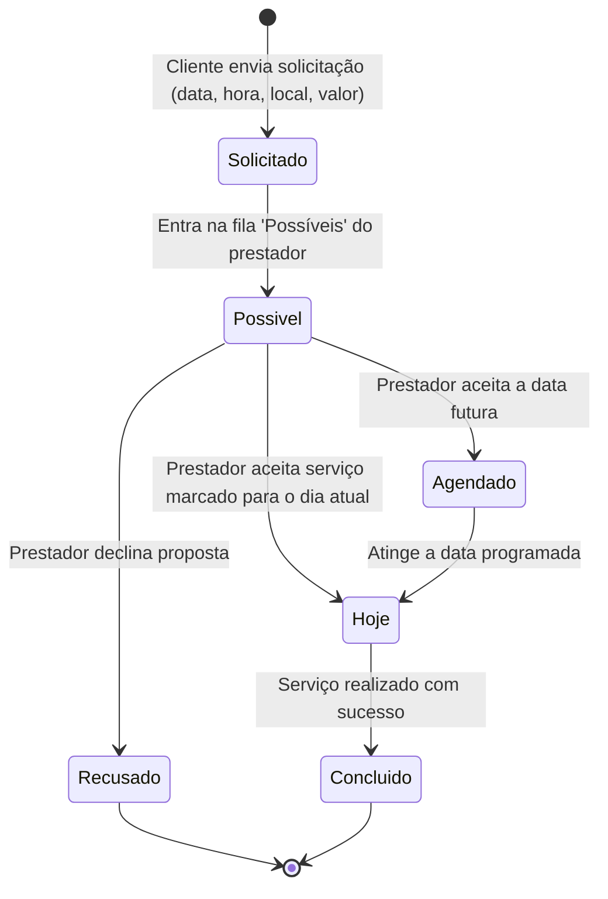

# 📘 LGI (Feira de Serviços) — Documento de Visão de Produto

> **Plataforma de Conexão, Portfólio Social e Marketplace Confiável para Serviços Autônomos**  
> *Versão do Documento: 1.0 • Foco: Visão de Negócio, Facilidades, Confiança e Regras do Produto*

---

## 📌 Sumário Executivo

1. [Visão Geral & Proposta de Valor](#1-visão-geral--proposta-de-valor)
2. [Atuação no Mercado e Dores que o Produto Resolve](#2-atuação-no-mercado-e-dores-que-o-produto-resolve)
3. [Facilidades do Produto (Experiência do Usuário)](#3-facilidades-do-produto-experiência-do-usuário)
   - [Facilidades para o Cliente (Contratante)](#31-facilidades-para-o-cliente-contratante)
   - [Facilidades para o Prestador de Serviços](#32-facilidades-para-o-prestador-de-serviços)
4. [Pilares de Confiança e Credibilidade](#4-pilares-de-confiança-e-credibilidade)
5. [Regras de Negócio do Produto](#5-regras-de-negócio-do-produto)
   - [Papéis e Perfis de Usuário](#51-papéis-e-perfis-de-usuário)
   - [Critérios de Elegibilidade](#52-critérios-de-elegibilidade)
   - [Ciclo de Vida do Agendamento e Gestão de Serviços](#53-ciclo-de-vida-do-agendamento-e-gestão-de-serviços)
   - [Catálogo Estruturado de Serviços e Especialidades](#54-catálogo-estruturado-de-serviços-e-especialidades)
6. [Diferenciais Competitivos frente ao Mercado](#6-diferenciais-competitivos-frente-ao-mercado)
7. [Roadmap e Próximos Passos do Produto](#7-roadmap-e-próximos-passos-do-produto)

---

## 1. Visão Geral & Proposta de Valor

O **LGI (Feira de Serviços)** nasceu para transformar a maneira como serviços manuais e técnicos são descobertos, negociados e executados no Brasil. 

Tradicionalmente, a contratação de profissionais autônomos (como eletricistas, encanadores, pintores, técnicos de informática e instaladores) depende de indicações informais em grupos de mensagens ou listas frias de classificados. Esse formato gera **insegurança para o cliente** (que não sabe se o profissional é qualificado e pontual) e **desvalorização para o prestador** (que não tem como comprovar a qualidade do seu trabalho prévio).

A **LGI** une a dinâmica visual e intuitiva de uma **rede social moderna** (estilo feed de fotos e vídeos) com a eficiência de um **marketplace transacional de serviços**.

### Proposta de Valor Central
- **Para o Cliente**: Encontrar o profissional ideal em minutos, podendo assistir vídeos reais de serviços anteriores, checar a nota de credibilidade e solicitar um agendamento com valor e horário pré-combinados.
- **Para o Prestador**: Um cartão de visitas digital de alto padrão ("Ficha Técnica"), com portfólio visual ilimitado, gestão de agenda mensal e previsibilidade financeira, sem intermediários abusivos.

---

## 2. Atuação no Mercado e Dores que o Produto Resolve

A LGI atua no segmento de **Marketplace de Serviços Locais (B2C e P2P)**, atendendo residências, condomínios e pequenas empresas que demandam manutenção, instalações e suporte técnico.

### Dores do Mercado Tradicional vs. Solução LGI

| Cenário Tradicional (Sem a LGI) | Com a Plataforma LGI |
| :--- | :--- |
| **"Indicação no escuro"**: O cliente contrata alguém por indicação de terceiros sem qualquer garantia ou histórico visual. | **Portfólio Transparente**: O cliente visualiza vídeos e fotos reais de obras e serviços finalizados pelo profissional. |
| **Preços arbitrários e surpresas**: O profissional cobra sem tabela de referência, gerando desconfiança mútua. | **Previsibilidade**: O perfil informa o valor/hora de referência e a proposta é enviada com estimativa clara. |
| **Negociação dispersa e caótica**: Detalhes combinados em conversas soltas de WhatsApp com risco de esquecimento de data e endereço. | **Ordem de Serviço Centralizada**: Data, hora, endereço, escopo e observações consolidados em um único painel. |
| **Prestador invisível**: Profissionais competentes não possuem site próprio nem verba para anúncios no Google. | **Vitrine Gratuita e Indexada**: Destaque por categoria profissional e especialidade técnica com alcance regional. |

### Nichos de Atuação Contemplados no Catálogo
- ⚡ **Eletricista**: Instalação residencial, quadros elétricos, iluminação, reparos emergenciais.
- 🚰 **Encanador**: Desentupimento, redes hidráulicas, caixas d'água, vazamentos e registros.
- ❄️ **Climatização**: Instalação e manutenção preventiva/corretiva de ar-condicionado.
- 🎨 **Pintor**: Pintura interna, externa, texturas, impermeabilização e verniz.
- 🔨 **Reformas e Construção**: Pedreiros, gesso, piso e acabamentos.
- 💻 **Tecnologia (TI)**: Formatação, cabeamento de rede, montagem de computadores, suporte a home office.
- 🌿 **Jardinagem & Paisagismo**: Poda, manutenção de gramados e áreas verdes.
- 🧹 **Limpeza**: Diaristas, higienização pós-obra e limpeza técnica.
- ⚙️ **Usinagem & Serralheria**: Estruturas metálicas, solda e peças sob encomenda.

---

## 3. Facilidades do Produto (Experiência do Usuário)

O produto foi desenhado com filosofia **Mobile-First**, priorizando agilidade no celular, telas limpas, botões acessíveis e opções de **Tema Claro e Escuro (Dark Mode)** para conforto visual.

### 3.1. Facilidades para o Cliente (Contratante)

1. **Busca Intuitiva por Categorias e Palavras-chave**:
   - Botões de seleção rápida (ex: *Eletricista, Encanador, Pintor, TI*).
   - Busca textual instantânea que localiza prestadores por nome, bairro/cidade ou descrição de habilidades.
2. **Feed Interativo de Mídia (Vitrine Viva)**:
   - Em vez de ler apenas textos frios, o contratante rola um feed com fotos e vídeos de serviços reais executados.
   - Pode curtir com duplo toque e ler comentários públicos de outros clientes.
3. **Contratação em Apenas 1 Clique (Modal de Solicitação)**:
   - Sem formulários burocráticos: basta selecionar a especialidade, data desejada, horário de preferência, endereço do chamado e uma observação com o problema.
   - O preço estimado é calculado com base no valor/hora do profissional.
4. **Painel "Minhas Solicitações"**:
   - Acompanhamento em tempo real para saber se o prestador aceitou, recusou ou se o atendimento está agendado para o dia corrente.

---

### 3.2. Facilidades para o Prestador de Serviços

1. **Ficha Técnica Profissional Completa**:
   - Cartão de visitas digital moderno exibindo:
     - Formação e tempo de experiência na área.
     - Especialidades técnicas certificadas.
     - Valor base por hora.
     - Nota de qualidade e selo de credibilidade.
     - E-mail comercial e contatos diretos.
2. **Publicação Simples de Conteúdo (Até 215 segundos)**:
   - O prestador tira foto ou grava um vídeo do serviço realizado no celular e publica no feed em segundos com uma descrição do trabalho.
   - Constrói autoridade orgânica e engajamento contínuo.
3. **Calendário Financeiro e Operacional Integrado**:
   - Visualização em formato de calendário mensal que destaca automaticamente os dias com serviços confirmados.
   - Elimina sobreposição de horários e conflitos de agenda.
4. **Quadro de Controle de Ordens de Serviço**:
   - Organização automática dos chamados em listas operacionais:
     - **Possíveis**: Oportunidades pendentes de análise e aceite.
     - **Hoje**: Serviços que devem ser executados na data atual (foco do dia).
     - **Agendados**: Compromissos futuros garantidos na agenda.
     - **Recusados**: Histórico de chamados que não puderam ser atendidos.

---

## 4. Pilares de Confiança e Credibilidade

A confiança é o principal ativo de um marketplace de serviços que envolve a entrada de prestadores em residências e empresas. A LGI estrutura sua credibilidade em 5 pilares:

1. **Identificação Documental Única (CPF / CNPJ)**:
   - Todo usuário é cadastrado com seu documento legal brasileiro oficial, impedindo perfis duplicados ou contas anônimas fraudulentas.
2. **Política Estrita de Maioridade Legal (18+ Anos)**:
   - O sistema valida a data de nascimento no momento do registro. Menores de idade não podem contratar nem prestar serviços na plataforma, assegurando conformidade jurídica e responsabilidade civil.
3. **Prova Social Real (A "Vitrine Viva")**:
   - Diferente de depoimentos em texto facilmente forjados, a plataforma encoraja vídeos e fotos detalhadas do processo de trabalho, permitindo ao contratante avaliar acabamento, ferramentas e postura profissional.
4. **Métricas Visíveis de Reputação**:
   - **Nota de Qualidade (1 a 5 Estrelas)**: Média de satisfação com base nos serviços executados.
   - **Índice de Credibilidade**: Nível de confiança institucional gerado pelo histórico de pontualidade, tempo na plataforma e confirmação de atendimentos.
5. **Recuperação Segura de Conta (OTP em 2 Etapas)**:
   - Fluxo de recuperação de senha via e-mail com código numérico temporizado (10 minutos de validade) para proteger os dados do prestador e seu faturamento.

---

## 5. Regras de Negócio do Produto

### 5.1. Papéis e Perfis de Usuário
O modelo do produto adota o conceito de **Conta Unificada**:
- Todo usuário registrado pode **contratar** serviços como cliente.
- Ao preencher os campos adicionais de sua **Ficha Técnica** (profissão, valor da hora, formação, tempo de experiência), o usuário passa a atuar também como **Prestador de Serviços**, aparecendo no catálogo público de busca.

---

### 5.2. Critérios de Elegibilidade e Cadastro
- **Documento Obrigatório**: CPF ou CNPJ válido e exclusivo por conta.
- **Idade Mínima**: 18 anos completos (calculado a partir da data de nascimento).
- **Dados Mínimos do Prestador**: Para listar no catálogo de busca, o prestador deve definir obrigatoriamente sua categoria de serviço, valor de hora e uma descrição do seu trabalho.

---

### 5.3. Ciclo de Vida do Agendamento e Gestão de Serviços

O fluxo de contratação segue uma máquina de estados transparente entre contratante e prestador:

#### Definição das Fases no Quadro de Serviços:
- **Possíveis (Aguardando Aceite)**: A proposta foi submetida pelo cliente. O prestador avalia se o valor proposto, local e horário são viáveis para sua rotina.
- **Agendados (Confirmados)**: Serviços já aceitos pelo prestador para datas futuras. O horário fica reservado no calendário.
- **Hoje (Operação Ativa)**: Serviços com execução programada para o dia corrente. Prioridade máxima na tela do prestador para deslocamento e realização.
- **Recusados (Arquivados)**: Propostas recusadas pelo prestador caso haja incompatibilidade de agenda, distância ou valor.

---

### 5.4. Catálogo Estruturado de Serviços e Especialidades
Para evitar cadastros genéricos que dificultam a busca, a plataforma utiliza uma taxonomia hierárquica em dois níveis:
1. **Classe de Serviço Principal** (ex: *Eletricista, Encanador, TI*).
2. **Especialidade Técnica** vinculada (ex: dentro de *Eletricista* -> *Instalação Padrão, Troca de Fiação, Quadros de Distribuição*).

Essa regra garante que um cliente que procura "Troca de Disjuntor" não receba uma lista genérica de profissionais da construção civil, encontrando exatamente o especialista qualificado.

---

## 6. Diferenciais Competitivos frente ao Mercado

Abaixo, a comparação entre a **LGI** e os modelos tradicionais do mercado:

| Atributo | Classificados Tradicionais (Ex: OLX) | Plataformas de Orçamento Pago (Ex: GetNinjas) | **Plataforma LGI** |
| :--- | :--- | :--- | :--- |
| **Experiência Visual** | Apenas fotos estáticas e sem padrão. | Quase nula (foco em texto e contato telefônico). | **Feed Social rico com vídeos até 215s e fotos de alta resolução.** |
| **Custo para o Prestador** | Mensalidade ou anúncios destacados. | O prestador paga moedas/créditos só para ter o telefone do cliente. | **Acesso direto com perfil e portfólio acessíveis.** |
| **Validação da Reputação** | Comentários sem contexto de execução real. | Avaliações textuais simples. | **Duplo pilar: Nota de Qualidade + Selo de Credibilidade + Histórico.** |
| **Gestão Operacional** | Nenhuma (negociação feita fora da plataforma). | Nenhuma ferramenta de agenda interna. | **Calendário interativo mensal e kanban de ordens de serviço em tempo real.** |
| **Facilidade de Contratação** | Troca manual de mensagens no chat. | Disputa de orçamentos por vários prestadores. | **Solicitação estruturada com data, hora, endereço e valor hora claro.** |

---

## 7. Roadmap e Próximos Passos do Produto

Para consolidar a LGI como o maior ecossistema de serviços da América Latina, o planejamento de produto contempla as seguintes fases de evolução:

1. **Custódia Financeira (Escrow) & Pagamentos Integrados**:
   - Integração com gateway de pagamentos (Pix e Cartão de Crédito).
   - O cliente paga no ato da contratação, o valor fica retido com segurança na plataforma e só é liberado para a conta do prestador após o aceite de conclusão do serviço.
2. **Chat e Mensageria Instantânea no App**:
   - Canal de comunicação em tempo real dentro da plataforma com compartilhamento de localização, áudio e fotos adicionais do local do serviço.
3. **Selo de Verificação de Antecedentes Criminais & Certificações**:
   - Parceria com órgãos de validação cadastral e de conselhos técnicos (ex: CFT/CREA para eletricistas) para emissão do selo "Profissional Verificado LGI".
4. **Clube de Benefícios e Desconto em Ferramentas**:
   - Parcerias com redes de materiais de construção e ferramentas (Makita, Bosch, Leroy Merlin) com cashback e descontos exclusivos para prestadores com alta nota de credibilidade.
5. **Garantia LGI de Satisfação**:
   - Seguro contra pequenos danos materiais ou cobertura de refação de serviço em caso de discordância técnica.

---

> 💡 **Conclusão:**  
> A **LGI** não é apenas uma lista de telefones; é um ecossistema completo que devolve a **dignidade e a autoridade aos profissionais autônomos**, ao mesmo tempo em que oferece ao consumidor final a **tranquilidade, segurança e previsibilidade** de contratar quem realmente entende do assunto.
