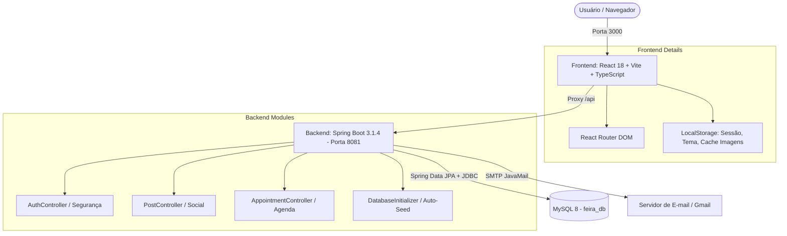

# LGI — Plataforma de Conexão e Marketplace de Serviços

> **LGI (Feira de Serviços)** é uma plataforma web full-stack, com interface *mobile-first* inspirada em redes sociais modernas, desenvolvida para conectar **prestadores de serviços autônomos** (eletricistas, encanadores, pintores, técnicos de TI, marceneiros, etc.) diretamente a **clientes e contratantes**.
>
> 📄 **Interessado na visão de produto e negócios?** Acesse o documento completo: [PRODUTO.md](file:///c:/Desenvolvimento/LGI/feira-/feira/PRODUTO.md) para detalhes sobre proposta de valor, atuação, regras de negócio e diferenciais de mercado.

---

## 📌 Sumário
1. [Visão Geral](#-visão-geral)
2. [Principais Funcionalidades](#-principais-funcionalidades)
3. [Arquitetura do Sistema](#-arquitetura-do-sistema)
4. [Tecnologias Utilizadas](#-tecnologias-utilizadas)
5. [Estrutura do Repositório](#-estrutura-do-repositório)
6. [Modelo de Dados (Banco de Dados)](#-modelo-de-dados-banco-de-dados)
7. [Endpoints da API REST](#-endpoints-da-api-rest)
8. [Como Executar o Projeto Localmente](#-como-executar-o-projeto-localmente)
9. [Boas Práticas e Pontos de Evolução](#-boas-práticas-e-pontos-de-evolução)

---

## 🌟 Visão Geral

O projeto resolve o atrito comum na busca, validação e contratação de serviços manuais e técnicos:
- **Para o Prestador**: Funciona como um cartão de visitas digital e rede social ("Ficha Técnica"), onde pode postar fotos e vídeos de serviços realizados (estilo feed do Instagram), receber curtidas e comentários, exibir sua nota de credibilidade, gerenciar sua agenda de serviços e monitorar seu faturamento financeiro.
- **Para o Cliente**: Permite buscar profissionais por especialidade e localização, comparar avaliações reais e qualificações, visualizar portfólio em fotos/vídeos e enviar solicitações de agendamento de serviço com data, horário e orçamento.

---

## 🚀 Principais Funcionalidades

### 1. Autenticação e Perfis (Ficha Técnica)
- **Cadastro e Login**: Cadastro validando documento (CPF/CNPJ), nome, data de nascimento (maioridade 18+ anos), e-mail e senha.
- **Ficha Técnica Profissional**: Definição de profissão (ex: Eletricista), especialidade (ex: Instalação Residencial), cidade/localização, valor por hora, tempo de experiência na área, formação e descrição detalhada.
- **Recuperação de Senha**: Fluxo com envio de código de 6 dígitos via e-mail (SMTP) com expiração temporal (10 minutos) e redefinição segura.
- **Tema Escuro / Claro**: Suporte nativo a Dark Mode e Light Mode com chaveamento dinâmico e persistência local.

### 2. Feed Social de Portfólio (Estilo Instagram)
- **Publicação de Mídia**: Upload e exibição de fotos e vídeos com legendas explicativas do serviço executado.
- **Engajamento**: Curtidas em tempo real (com suporte a toque duplo na imagem) e comentários públicos.
- **Gestão do Autor**: O prestador pode excluir seus próprios posts com confirmação visual, limpando automaticamente curtidas e comentários vinculados.

### 3. Busca e Contratação de Prestadores
- **Catálogo de Profissionais**: Busca dinâmica com filtro por categorias predefinidas (Eletricista, Encanador, TI, Pintor, Jardinagem, etc.) e pesquisa textual por nome ou descrição.
- **Página de Perfil do Prestador**: Exibição pública de qualificações, avaliações, portfólio completo de posts e canal direto de contratação.
- **Solicitação de Agendamento**: Modal de contratação onde o cliente especifica serviço, data, hora, endereço, valor proposto e observações.

### 4. Módulo Financeiro & Controle de Serviços
- **Calendário Interativo**: Visualização mensal de agendamentos (`appointments`) com marcação de dias ocupados.
- **Quadro de Gestão de Ordens de Serviço**:
  - **Possíveis**: Solicitações recebidas aguardando aprovação do prestador.
  - **Hoje**: Serviços confirmados com execução marcada para a data atual.
  - **Agendados**: Compromissos confirmados para datas futuras.
  - **Recusados**: Solicitações declinadas.
- **Minhas Solicitações**: Painel onde o cliente acompanha o status de aprovação dos serviços solicitados.

---

## 🏗 Arquitetura do Sistema

A aplicação segue uma arquitetura client-server desacoplada:



---

## 💻 Tecnologias Utilizadas

### Frontend
- **React 18** com **TypeScript** (Strict mode)
- **Vite 5**: Ferramenta de build rápida e servidor de desenvolvimento local.
- **React Router DOM 6**: Gerenciamento de rotas e navegação SPA.
- **CSS3 Vanilla**: Estilização com design system coeso, suporte a variáveis CSS, micro-interações, responsividade e Dark Mode.

### Backend
- **Java 17**
- **Spring Boot 3.1.4**
- **Spring Data JPA / Hibernate**: Mapeamento objeto-relacional e queries JPQL.
- **Spring JDBC (JdbcTemplate)**: Execução de consultas dinâmicas e integração com tabelas auxiliares.
- **Spring Boot Starter Mail**: Integração SMTP para envio de códigos de recuperação de conta.
- **MySQL Connector/J**: Driver oficial de conexão JDBC.

### Banco de Dados
- **MySQL 8.x** (banco `feira_db` com charset `utf8mb4_unicode_ci`).
- **DatabaseInitializer**: Componente de inicialização automática no boot do Spring que executa o script `seed.sql` caso o banco ainda não esteja populado.

---

## 📁 Estrutura do Repositório

```text
feira/
├── backend/                                # API Spring Boot
│   ├── pom.xml                             # Dependências Maven (Spring Boot, MySQL, Mail)
│   └── src/main/
│       ├── java/com/lgi/
│       │   ├── Application.java            # Classe principal de inicialização
│       │   ├── config/
│       │   │   ├── CorsConfig.java         # Configurações de CORS globais
│       │   │   └── DatabaseInitializer.java# Auto-seeding do banco de dados na inicialização
│       │   ├── controller/
│       │   │   ├── AppointmentController.java # Endpoints de agendamento e controle de serviços
│       │   │   ├── AuthController.java     # Autenticação, usuários, recuperação de senha e catálogo
│       │   │   ├── PostController.java     # Publicações, likes e comentários
│       │   │   └── RootController.java     # Redirecionamento da raiz
│       │   ├── model/                      # Entidades JPA (Login, Post, Comment, Like, Appointment)
│       │   ├── repository/                 # Interfaces Spring Data JPA
│       │   └── service/
│       │       └── EmailService.java       # Serviço de envio de e-mails via JavaMail
│       └── resources/
│           ├── application.properties      # Configurações de porta, conexão MySQL e SMTP
│           └── db/
│               └── seed.sql                # Script DDL e DML inicial (tabelas e especialidades)
│
└── frontend/                               # Interface Web (SPA)
    ├── package.json                        # Scripts e dependências React
    ├── vite.config.ts                      # Configuração Vite e proxy reverso para backend
    └── src/
        ├── App.tsx                         # Roteador principal e gerenciador de tema
        ├── main.tsx                        # Entry point React
        ├── styles.css                      # Design system e estilos de toda a aplicação
        ├── pages/
        │   ├── Login.tsx                   # Tela de login e modal de recuperação
        │   ├── Register.tsx                # Tela de cadastro de novos usuários
        │   ├── Main.tsx                    # Hub principal: Início (Feed), Busca, Financeiro, Perfil
        │   ├── Prestador.tsx               # Perfil público de terceiros e contratação
        │   └── Post.tsx                    # Visualização detalhada de publicação individual
        └── components/
            ├── BottomNav.tsx               # Barra de navegação inferior mobile
            ├── CardPrestador.tsx           # Cartão do prestador para lista de busca
            ├── FinanceiraTab.tsx           # Calendário, métricas e controle de chamados
            ├── PasswordRecoveryModal.tsx   # Modal de 3 etapas para redefinição de senha
            ├── PostCard.tsx                # Card de post com likes, comentários e ações
            ├── PostModal.tsx               # Modal de criação de novos posts com mídia
            ├── ProfileEditModal.tsx        # Edição completa de perfil profissional
            └── UserSettingsModal.tsx       # Configurações de conta e segurança
```

---

## 🗄 Modelo de Dados (Banco de Dados)

### Principais Tabelas

| Tabela | Chave Primária | Descrição |
| :--- | :--- | :--- |
| `login` | `documento_log` (CPF/CNPJ) | Usuários, credenciais e ficha técnica profissional |
| `posts` | `id` (AUTO_INCREMENT) | Publicações do portfólio (fotos/vídeos em base64 e descrição) |
| `comments` | `id` (AUTO_INCREMENT) | Comentários nas publicações vinculados ao documento do autor |
| `post_likes` | `id` (AUTO_INCREMENT) | Curtidas em posts com restrição única `(post_id, user_documento)` |
| `appointments` | `id` (AUTO_INCREMENT) | Agendamentos de serviços entre cliente (`cli_id`) e prestador (`pre_id`) |
| `serviço` | `cod_serv` | Categorias principais de serviços (Eletricista, Encanador, TI, etc.) |
| `serviço1` | `cod_serv1` | Especialidades específicas filhas de cada serviço |

---

## 🔌 Endpoints da API REST

### Autenticação & Usuários (`/api`)
- `POST /api/login`: Autentica usuário com documento/e-mail e senha.
- `POST /api/register`: Cadastra um novo usuário no sistema.
- `GET /api/user/{documento}`: Retorna a ficha técnica completa do usuário.
- `PUT /api/user/{documento}`: Atualiza os dados de perfil do usuário.
- `GET /api/providers`: Lista prestadores cadastrados para a tela de busca.
- `POST /api/forgot-password`: Gera e envia código de recuperação de senha por e-mail.
- `POST /api/verify-recovery-code`: Valida código de recuperação informado.
- `POST /api/reset-password-recovery`: Atualiza a senha usando o código validado.
- `GET /api/services`: Lista categorias de serviço cadastradas.
- `GET /api/specialties/{serviceCode}`: Lista especialidades por código de serviço.

### Feed & Publicações (`/api/posts`)
- `GET /api/posts?currentUser={doc}`: Retorna o feed completo com indicação de likes do usuário logado.
- `GET /api/posts/user/{documento}`: Retorna publicações de um autor específico.
- `GET /api/posts/{id}`: Retorna uma publicação individual.
- `POST /api/posts`: Cria uma nova publicação com mídia e legenda.
- `DELETE /api/posts/{id}`: Exclui publicação (apenas pelo autor proprietário).
- `POST /api/posts/{id}/like`: Registra curtida no post.
- `POST /api/posts/{id}/unlike`: Remove curtida do post.
- `GET /api/posts/{id}/comments`: Lista os comentários de um post.
- `POST /api/posts/{id}/comments`: Adiciona um novo comentário.

### Agendamentos & Agenda Financeira (`/api/appointments`)
- `GET /api/appointments?year=YYYY&month=MM&prestadorId={id}`: Busca agendamentos do mês para o calendário.
- `POST /api/appointments`: Registra uma nova solicitação de serviço/agendamento.
- `GET /api/appointments/controle/{prestadorId}`: Retorna listas agrupadas (Possíveis, Hoje, Agendados, Recusados).
- `PUT /api/appointments/{id}/status-servico`: Altera o status do serviço (aceito, recusado, pendente).
- `GET /api/appointments/minhas-solicitacoes/{clienteId}`: Histórico de solicitações do cliente contratante.

---

## 🛠 Como Executar o Projeto Localmente

### Pré-requisitos
- **Java 17 JDK** instalado e configurado no PATH.
- **Node.js 18+** e **npm**.
- A senha do banco PostgreSQL do projeto no Supabase.
- **Apache Maven 3.8+** (ou utilizar o wrapper da sua IDE).

### 1. Configurar o Banco de Dados
Crie um arquivo `.env` na raiz do projeto com `SUPABASE_DB_PASSWORD=sua-senha-do-banco`. Esse arquivo é ignorado pelo Git; o Spring Boot o carrega ao iniciar a partir da pasta `backend`, e o Docker Compose o usa automaticamente.

O backend conecta diretamente ao PostgreSQL do Supabase usando SSL. A senha é lida do ambiente e não deve ser adicionada ao repositório. O script `backend/src/main/resources/db/seed.sql` usa sintaxe MySQL; seus dados iniciais não são compatíveis com PostgreSQL sem conversão.

### 2. Iniciar o Backend
Abra um terminal na pasta do backend:
```bash
cd backend
mvn spring-boot:run
```
O servidor iniciará na porta **8081** (conforme configurado em `application.properties`).

### 3. Iniciar o Frontend
Em outro terminal, acesse a pasta do frontend:
```bash
cd frontend
npm install
npm run dev
```
O Vite iniciará o servidor de desenvolvimento na porta **3000** em `http://localhost:3000`. Todas as chamadas para `/api/*` serão redirecionadas automaticamente pelo proxy do Vite para `http://127.0.0.1:8081`.

---

## 💡 Boas Práticas e Pontos de Evolução

- [ ] **Criptografia de Senhas**: Implementar hash seguro (ex: `BCryptPasswordEncoder` com Spring Security) para armazenamento das credenciais.
- [ ] **Autenticação Baseada em Tokens**: Migrar a persistência de sessão de `localStorage` simples para **JWT (JSON Web Tokens)** ou sessões seguras com cookies `HttpOnly`.
- [ ] **Armazenamento de Mídia**: Substituir armazenamento de fotos/vídeos em Base64 no banco de dados por um serviço de Object Storage (como AWS S3, Cloudinary ou MinIO).
- [ ] **Gateway de Pagamento**: Integração com APIs como Mercado Pago, Stripe ou Pix para pagamento direto e garantia de custódia do serviço.
- [ ] **Notificações em Tempo Real**: Adicionar WebSockets ou Push Notifications para alertar novos agendamentos e interações nos posts.
